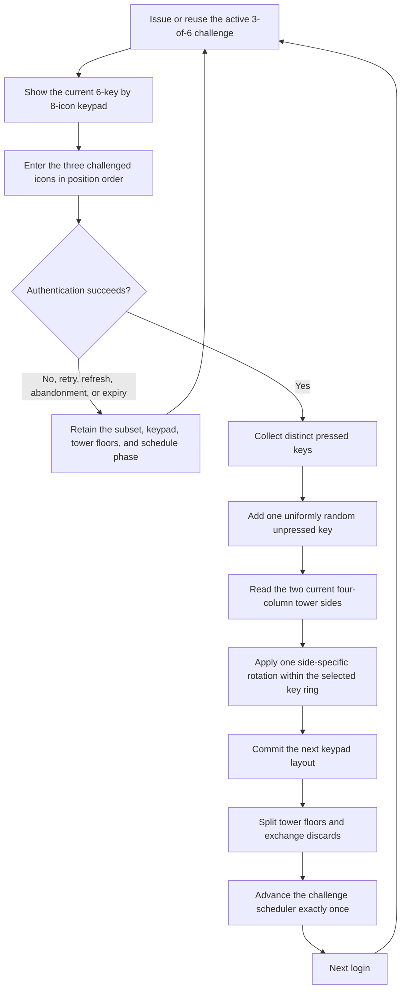

# Selective Key Rotation and 3-of-6 Challenge Schedules

## Purpose and status

This document specifies an experiment for reducing how much of a keypad moves
after a successful 3-of-6 login. It compares two ways to choose the three
secret positions requested on each login:

- **uniform**: independently choose one of the 20 possible 3-of-6 subsets; and
- **alternating-halves**: alternate `{1, 2, 3}` and `{4, 5, 6}`.

Both schedules use the same selective keypad shuffle. The shuffle rotates only
the keys that were pressed plus one additional key. It retains the existing
column-tower algorithm, including its floor history, while avoiding whole-key
swaps.

This document describes the experiment implemented by
`src.challenge_subset`, `src.challenge_schedule`, `src.challenge_protocol`,
and `SelectiveTowerShuffleKeypad`. It does not select a production schedule
or define a production authentication protocol.

## Vocabulary and fixed parameters

| Term | Meaning |
|---|---|
| Secret position | One place in the ordered six-icon secret |
| Challenge | Three distinct secret positions, entered in ascending order |
| Key | One of the six clickable keypad rows |
| Icon-set column | One of eight columns containing one icon on every key |
| Pressed key | A key containing at least one challenged secret icon |
| Rotation key | A distinct pressed key or the one additional unpressed key |
| Tower side | One of the two four-column partitions maintained by the tower |

The experiment uses:

```text
clickable keys       = 6
icons per key        = 8
total icons          = 48
secret positions     = 6
challenged positions = 3
```

Secret positions are numbered `1…6` in this document. The Python implementation
represents them as `0…5`.

## Starting keypad

The examples use numbers as icon identifiers:

| Key | C0 L | C1 R | C2 L | C3 R | C4 L | C5 R | C6 L | C7 R |
|---|---:|---:|---:|---:|---:|---:|---:|---:|
| K0 | 0 | 1 | 2 | 3 | 4 | 5 | 6 | 7 |
| K1 | 8 | 9 | 10 | 11 | 12 | 13 | 14 | 15 |
| K2 | 16 | 17 | 18 | 19 | 20 | 21 | 22 | 23 |
| K3 | 24 | 25 | 26 | 27 | 28 | 29 | 30 | 31 |
| K4 | 32 | 33 | 34 | 35 | 36 | 37 | 38 | 39 |
| K5 | 40 | 41 | 42 | 43 | 44 | 45 | 46 | 47 |

For readability, this example labels the current tower sides:

```text
left tower  = C0, C2, C4, C6
right tower = C1, C3, C5, C7
```

The real tower partition is randomized and evolves after every successful
login. With eight columns, each side always contains four columns.

## Challenge schedules

### Uniform

For every new successful-login cycle:

1. sample three distinct positions uniformly from `1…6`;
2. sort them into ascending secret-position order; and
3. retain that challenge until authentication succeeds.

There are:

```text
C(6, 3) = 20
```

possible challenges. Every new draw is independent, so consecutive challenges
may repeat.

For a fixed current subset, the next uniform subset has this overlap
distribution:

| Shared secret positions | Number of next subsets | Probability |
|---:|---:|---:|
| 0 | 1 | 1/20 = 5% |
| 1 | 9 | 9/20 = 45% |
| 2 | 9 | 9/20 = 45% |
| 3 | 1 | 1/20 = 5% |

The counts follow
`C(3, shared) × C(3, 3 - shared)`.

### Alternating halves

The first challenge is:

```text
{1, 2, 3}
```

After a successful login, the next challenge is:

```text
{4, 5, 6}
```

The schedule then alternates between those two subsets:

```text
login 1: {1, 2, 3}
login 2: {4, 5, 6}
login 3: {1, 2, 3}
login 4: {4, 5, 6}
...
```

Consecutive challenges have zero overlap. Every secret position is challenged
after two successful observations, and each half is revisited every other
successful login. The next challenge is completely predictable from the
current phase, and the other 18 subsets are never used.

### Challenge lifetime

Neither scheduler advances merely because a challenge was viewed or attempted.

- Failure, retry, refresh, or abandonment retains the same challenge and
  keypad.
- Expiry may replace a challenge identifier or nonce, but retains the same
  subset, keypad, and alternating phase.
- Exactly one successful authentication advances both the keypad state and
  challenge schedule exactly once.
- Duplicate success completion must not cause a second shuffle or schedule
  advance.

These rules prevent a client from cycling challenges until it receives a
preferred subset.

## Selective tower shuffle

The selective shuffle runs only after a successful login.

### 1. Choose the rotation keys

Let `U` be the set of distinct keys pressed for the three challenged icons.
Because several icons can be on the same key:

```text
1 <= |U| <= 3
```

Choose one additional key uniformly from the six keys not in `U`. The rotation
set is:

```text
S = U union {one random unpressed key}
```

Therefore, the shuffle touches:

| Distinct pressed keys | Added keys | Rotation keys |
|---:|---:|---:|
| 1 | 1 | 2 |
| 2 | 1 | 3 |
| 3 | 1 | 4 |

Order the rotation keys by key number to form a cyclic ring. All keys outside
that ring remain untouched.

### 2. Apply one transformation per tower side

The current tower state partitions the eight icon-set columns into two
four-column sides.

When the rotation ring contains two keys:

1. choose one tower side uniformly;
2. swap that side's columns between the two rotation keys; and
3. leave the other tower side fixed.

This is a swap-plus-identity transformation. It does not swap entire keys.

When the rotation ring contains three or four keys:

1. choose two distinct nonzero cyclic shifts uniformly without replacement;
2. assign one shift to each tower side; and
3. apply each shift only within the rotation ring.

All icons remain in their original icon-set columns. Icons on keys outside the
rotation ring remain on the same keys.

### 3. Evolve the column towers

After changing the layout:

1. split every floor in both towers into balanced keep and discard parts;
2. retain the keep parts in their existing floor order;
3. exchange the discarded columns between the towers; and
4. append each incoming discard as a new floor.

Floor history is preserved. Storing only the current four-column membership of
each side is not equivalent to storing the tower state.

## Worked example: one distinct pressed key

Suppose the challenged secret icons are `0`, `1`, and `2`. They are all on
`K0`, so the observed entry is:

```text
K0, K0, K0
```

Choose `K1` as the additional key. The rotation ring is `[K0, K1]`. Suppose
the left tower is selected for the swap and the right tower is fixed.

The next keypad is:

| Key | C0 L | C1 R | C2 L | C3 R | C4 L | C5 R | C6 L | C7 R |
|---|---:|---:|---:|---:|---:|---:|---:|---:|
| K0 | 8 | 1 | 10 | 3 | 12 | 5 | 14 | 7 |
| K1 | 0 | 9 | 2 | 11 | 4 | 13 | 6 | 15 |
| K2 | 16 | 17 | 18 | 19 | 20 | 21 | 22 | 23 |
| K3 | 24 | 25 | 26 | 27 | 28 | 29 | 30 | 31 |
| K4 | 32 | 33 | 34 | 35 | 36 | 37 | 38 | 39 |
| K5 | 40 | 41 | 42 | 43 | 44 | 45 | 46 | 47 |

The challenged icons move as follows:

```text
0: K0 -> K1  (left tower)
1: K0 -> K0  (right tower, fixed)
2: K0 -> K1  (left tower)
```

All eight icons that an observer associated with the old `K0` now occupy two
possible destination keys:

```text
left-tower candidates  -> K1
right-tower candidates -> K0
```

Only eight icons move: four left-tower columns on each of the two rotation
keys. The other 40 icons stay on their previous keys for this shuffle.

## Worked example: two distinct pressed keys

Suppose the three challenged icons occupy `K0` and `K2`. Choose `K4` as the
additional key, producing the ordered ring:

```text
[K0, K2, K4]
```

Apply shift `+1` to the left tower and shift `+2` to the right tower:

```text
left:  K0 -> K2 -> K4 -> K0
right: K0 -> K4 -> K2 -> K0
```

The next keypad is:

| Key | C0 L | C1 R | C2 L | C3 R | C4 L | C5 R | C6 L | C7 R |
|---|---:|---:|---:|---:|---:|---:|---:|---:|
| K0 | 32 | 17 | 34 | 19 | 36 | 21 | 38 | 23 |
| K1 | 8 | 9 | 10 | 11 | 12 | 13 | 14 | 15 |
| K2 | 0 | 33 | 2 | 35 | 4 | 37 | 6 | 39 |
| K3 | 24 | 25 | 26 | 27 | 28 | 29 | 30 | 31 |
| K4 | 16 | 1 | 18 | 3 | 20 | 5 | 22 | 7 |
| K5 | 40 | 41 | 42 | 43 | 44 | 45 | 46 | 47 |

The old `K0` candidate set again has only two immediate destinations:

```text
left-tower candidates  -> K2
right-tower candidates -> K4
```

All 24 icons on the three rotation keys move. The 24 icons on `K1`, `K3`, and
`K5` remain untouched.

With three distinct pressed keys, the same rule adds one key and rotates a
four-key ring. Its 32 icons move, while the other 16 remain untouched.

## Immediate destination invariant

For any key pressed in an observed login, its eight candidate icons are divided
by the two current tower sides:

```text
four candidates use the left transformation
four candidates use the right transformation
```

Because the two transformations have distinct destinations, the old
eight-icon candidate set reaches exactly two keys after one successful
selective shuffle.

This is true for:

- two rotation keys using swap plus identity;
- three rotation keys using two distinct nonzero shifts; and
- four rotation keys using two distinct nonzero shifts.

Adding more rotation keys does not create a third immediate destination. The
number of destinations comes from the number of column treatments, not the
number of keys in the rotation ring.

This is only a one-shuffle invariant. Tower membership evolves and later
challenges may select different rotation keys, so candidate support can expand
or contract across multiple observations. Equal immediate destination counts
do not prove equal long-term replay resistance.

## End-to-end state flow

Challenge scheduling and keypad-column towers use independent state and random
streams.



In a future production protocol, the server-owned challenge transition and the
client-owned keypad transition must both be tied to an authenticated success.
The synchronization mechanism and recovery behavior are outside this
experiment.

## Candidate-space baseline

Under the benchmark's independent-position model, one observation narrows each
of three challenged positions to the eight icons on its pressed key. The other
three secret positions remain unconstrained over the 48-icon corpus:

```text
8³ × 48³ = 56,623,104 candidate secrets
```

This is not the same as the blind login space. A login contains three presses,
each with six possible keys:

```text
6³ = 216 key sequences
```

Attempt limits remain necessary regardless of challenge schedule.

## Security hypotheses

The proposed benchmark should test rather than assume the following:

### Uniform schedule

- Consecutive overlap sometimes re-observes already narrowed positions and may
  accelerate immediate replay.
- Uneven position coverage may delay learning the entire six-position secret.
- The next subset is not predictable before challenge issuance.
- All 20 challenge-specific paths remain exercised.

### Alternating-halves schedule

- Zero consecutive overlap avoids immediately challenging the same positions.
- Two observations cover the entire secret, which may accelerate a full crack.
- Each half receives a new observation every other successful login.
- The next subset is predictable and only two challenge-specific paths are
  exercised.

### Selective shuffle

- Touching fewer keys may preserve more information for a longitudinal
  observer.
- The fixed tower side in a two-key shuffle may create exploitable fixed-point
  history even though it preserves two immediate destinations.
- Evolving tower membership may eventually move icons that were fixed in an
  earlier two-key shuffle.
- Adding one unpressed key prevents the one-key case from degenerating into no
  movement.

## Benchmark implementation

The benchmark compares two cohorts using the same selective shuffle:

| Challenge schedule | Selection rule |
|---|---|
| `uniform` | Independent uniform draw from all 20 subsets |
| `alternating-halves` | `{1,2,3}`, `{4,5,6}`, then repeat |

Trials should share the same secret, initial keypad, and initial column-tower
state. Challenge selection, extra-key selection, cyclic-shift selection, and
tower-floor splitting should use deterministic, domain-separated random
streams so one policy cannot change another policy's random consumption.

Record:

- observations until at most three full-secret candidates remain;
- observations until the next challenge has at most three possible key
  sequences;
- optimal three-try success probability for the next challenge;
- distinct secret positions observed after every login;
- consecutive challenge overlap;
- number of rotation keys;
- number and fraction of icons moved; and
- persistence of candidates on fixed columns.

Results must identify both the challenge schedule and keypad shuffle. The
benchmark should report paired deltas without treating either schedule as the
production recommendation.

## Experiment invariants

The automated tests verify:

- every challenge contains three distinct, sorted positions from `1…6`;
- uniform selection can produce all 20 subsets;
- alternating selection produces only the two configured halves;
- failure, retry, refresh, abandonment, and expiry do not advance either
  schedule;
- one successful login advances the layout and schedule once;
- duplicate success completion cannot advance either state twice;
- rotation keys equal the distinct pressed keys plus one unpressed key;
- every rotation is a per-column permutation with no lost or duplicated icons;
- icons remain in their original icon-set columns;
- keys outside the rotation ring remain unchanged;
- an old pressed-key candidate set has exactly two immediate destinations;
- tower floors remain a disjoint partition of all eight columns; and
- seeded runs are reproducible without sharing mutable state or random streams
  between challenge scheduling and keypad shuffling.
