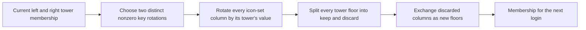

# Tower Shuffle and 3-of-6 Challenge Subsets

## Purpose and status

This document explains:

1. the current four-icon nKode keypad (`4-of-4`);
2. the tower shuffle used by `nKode-rs`;
3. the proposed `3-of-6` challenge-subset idea; and
4. exactly what the `evilnkode` experiment does and does not validate.

I interpret “the 4 nKode keypad” as the current flow in which the user
memorizes four ordered icons and enters all four on every login.

> **Important conclusion**
>
> The Python implementation is an observation-attack experiment. It is not a
> production implementation of 3-of-6 authentication.
>
> The tower-shuffle behavior in the experiment matches the Rust login shuffle.
> The subset observation model also matches the supplied brief under its stated
> independent-position assumptions. However, `nKode-rs` does not currently
> issue subset challenges or verify a three-icon response against a six-icon
> nKode. That protocol work remains to be designed.

This assessment compared `evilnkode` with `nKode-rs` at commit
`a71b2bf623c492d7645f706bf420ea5c172b5967`.

## Vocabulary

The two repositories use different names for the same layout concepts.

| Concept | `evilnkode` name | `nKode-rs` name | Default |
|---|---|---|---:|
| Clickable keypad rows | keys | groups | 6 |
| Icons shown on each key | properties per key / icons per key | icons per group | 9 |
| Total icon corpus | keys × icons per key | total icons | 54 |
| Ordered memorized icons | passcode / secret | nKode / code indices | 4 today; 6 proposed |
| Key numbers entered at login | key selection | selected groups | 4 today; 3 proposed |

The word **position** is overloaded, so this document distinguishes:

- **secret position**: an icon’s place in the memorized sequence, such as
  “icon 5 of the six-icon secret”;
- **key**: one of the six clickable keypad rows; and
- **icon-set column**: one of the nine underlying columns containing one icon
  on every key.

## The 6 × 9 keypad

The default login keypad contains 54 icons:

```text
                 nine icon-set columns
              S0  S1  S2  S3  S4  S5  S6  S7  S8
key 0          •   •   •   •   •   •   •   •   •
key 1          •   •   •   •   •   •   •   •   •
key 2          •   •   •   •   •   •   •   •   •
key 3          •   •   •   •   •   •   •   •   •
key 4          •   •   •   •   •   •   •   •   •
key 5          •   •   •   •   •   •   •   •   •
```

Each icon-set column always contains six icons, one on each key. A login
shuffle moves those icons among the six keys. It does not change the icon
corpus and does not move an icon into a different icon-set column.

The user does not need to know the columns. They find a remembered icon and
press the key currently containing it.

## Current four-icon nKode (`4-of-4`)

Suppose the ordered nKode is:

```text
[A, B, C, D]
```

On every login:

1. the application shows the current 6 × 9 layout;
2. the user finds `A` and presses its key;
3. the user finds `B`, `C`, and `D` in order and presses their keys;
4. the client reconstructs the full four-icon passcode; and
5. after a successful login, the layout is tower-shuffled for the next login.

The same four secret positions are exposed on every observed login.

For an observer who sees the entire keypad and the four pressed keys, one
recording leaves nine possible icons at each secret position:

```text
candidate counts after one observation = [9, 9, 9, 9]
full candidates                           = 9⁴ = 6,561
```

This is candidate-secret space, not blind login space. A blind login has six
possible keys for each of four presses:

```text
one blind guess   = 1 / 6⁴ = 1 / 1,296
three blind tries = 3 / 1,296 ≈ 0.23%
```

## How the tower shuffle works

The tower shuffle is not an unconstrained shuffle of all 54 icons.

### 1. Partition the nine icon-set columns

At initialization, the nine columns are randomly divided between two towers.
For example:

```text
left tower  = [S1, S4, S7, S8]
right tower = [S0, S2, S3, S5, S6]
```

The real partition is random. With nine columns, one side begins with four and
the other with five.

### 2. Choose two different nonzero rotations

For six keys, the allowed rotations are `1, 2, 3, 4, 5`.

The shuffle chooses two distinct values, for example:

```text
left shift  = +1 key
right shift = +4 keys
```

Every column in the left tower receives the left shift. Every column in the
right tower receives the right shift.

If icon `A` is in a left-tower column and currently on key 2, a `+1` rotation
moves it to key 3. If icon `B` is in a right-tower column on key 2, a `+4`
rotation moves it to key 0, wrapping around the six keys.

Because both rotations are nonzero, every icon moves to another key. Because
the rotations are distinct, the two tower partitions do not move together.

### 3. Evolve the towers for the next login

Each tower remembers its membership as a stack of floors.

After moving the icons:

1. each floor is randomly split into a **keep** part and a **discard** part;
2. the split is balanced so the two parts differ in size by no more than one;
3. the retained icons keep their existing floor order;
4. the left tower appends the right tower’s discarded columns as a new floor;
5. the right tower appends the left tower’s discarded columns as a new floor.

This exchanged membership determines which columns share a rotation on the
next login.



### What the tower shuffle guarantees

- All 54 icons remain present exactly once.
- Every icon stays in its original icon-set column.
- Every icon moves to a different key on each login shuffle.
- The two current tower partitions use different rotations.
- Tower membership changes after each shuffle.

It does **not** make all possible 54-icon layouts equally likely. Columns in
the same tower are correlated because they receive the same rotation. The
experiment measures the security consequence of that correlation rather than
assuming it is harmless.

### Rust-to-Python parity

The production Rust behavior is in:

- `nKode-rs/nkode_core/src/layout.rs`,
  `ShuffledLayout::login_shuffle`; and
- `nKode-rs/nkode_core/src/tower.rs`,
  `TowerShuffle::shuffle` and `Tower::split_tower`.

The Python equivalents are:

- [`SlidingTowerShuffleKeypad.shuffle`](../src/keypad/keypad.py); and
- [`TowerShuffle` and `Tower`](../src/keypad/tower_shuffle.py).

Both implementations:

1. read current left-tower membership;
2. choose two distinct values from the nonzero rotations;
3. apply the first to the left partition and the second to the right;
4. update the layout;
5. split both towers; and
6. append the other tower’s discarded floor in the same order.

The experiment’s tower shuffle is therefore a faithful model of the Rust
login shuffle.

## The random-shuffle comparison

`RandomShuffleKeypad` independently permutes the six icons in every icon-set
column. It preserves the same 54 icons and the same nine columns, but it does
not retain the tower correlations.

Rust’s enrollment `random_shuffle` also shuffles whole key rows before
independently shuffling the columns. The Python comparison omits that separate
whole-row permutation. A whole-row permutation only renames all six keys
together; it does not change candidate counts, replay support, or optimal
guess probabilities. The random comparison is therefore equivalent for the
attack metrics used here, although it is not byte-for-byte RNG parity.

## Proposed 3-of-6 challenge subset

The proposed memorized secret has six ordered icons:

```text
[A, B, C, D, E, F]
```

There are `C(6, 3) = 20` possible three-position challenges.

For one login, the application might prescribe:

```text
challenge = [2, 5, 6]
```

The user enters:

```text
[B, E, F]
```

The challenge positions are always distinct and presented in ascending order.
The user must enter the requested icons in that order.

The server—not the user—must choose the challenge and bind it to the login
session. Accepting any three of the six would define a different and much
weaker authentication rule.

### What one observer learns

Before any observation, the independent-position model starts with 54
possible icons at every secret position:

```text
[54, 54, 54, 54, 54, 54]
```

After observing challenge `[2, 5, 6]`, only those positions are updated:

```text
[54, 9, 54, 54, 9, 9]
```

Therefore the brief’s one-recording closed form is:

```text
9³ × 54³ = 114,791,256 full-secret candidates
```

Later observations intersect the candidate set for every position they
challenge. Unchallenged positions retain their previous candidate sets.

### Comparison with standard 4-of-4

| Property | Standard 4-of-4 | Proposed 3-of-6 |
|---|---:|---:|
| Ordered icons memorized | 4 | 6 |
| Secret positions requested per login | all 4 | random 3 of 6 |
| Possible challenges | 1 | 20 |
| Key presses | 4 | 3 |
| One-guess blind space | `6⁴ = 1,296` | `6³ = 216` |
| Three-try blind success | `3/1,296 ≈ 0.23%` | `3/216 ≈ 1.39%` |
| Candidates after first observation | `9⁴ = 6,561` | `9³ × 54³ = 114,791,256` |
| Secret positions exposed per recording | 100% | 50% |

The tradeoff is deliberate:

- 3-of-6 reveals much less of the memorized secret per observation;
- but three key presses have a smaller blind space than four key presses.

The three-attempt lockout is part of the evaluated threat model, not a detail
that can be removed without changing the result.

## What the experiment actually implements

The experiment is in
[`src/challenge_subset.py`](../src/challenge_subset.py).

For each paired trial it:

1. selects six distinct secret icons from the 54-icon corpus;
2. pre-generates uniformly random three-position observation challenges;
3. stores every challenge as a sorted tuple;
4. gives the random and tower shuffles the same secret and challenge sequence;
5. gives each shuffle an independent deterministic layout RNG stream;
6. records the visible keypad and the three pressed keys;
7. updates only the three challenged secret positions;
8. shuffles the keypad and repeats; and
9. stops measuring at the configured 30-observation cap.

### Attack state

[`AttackState`](../src/evilnkode.py) stores one candidate-icon set per secret
position.

For an observation, it intersects each challenged position with the nine icons
visible on the pressed key:

```text
candidates[position] =
    candidates[position] ∩ icons_on_observed_key
```

It exposes three different quantities.

#### Remaining full-secret combinations

```text
product of the six candidate-set sizes
```

The benchmark says the secret is **cracked** when this product is no more than
the three allowed attempts.

#### Challenge-specific replay support

For each requested secret position, the evaluator maps all remaining candidate
icons onto the keys containing them in the next layout. It counts the distinct
possible key sequences across the three requested positions.

If that support is no more than three, the attacker can cover every possible
sequence within the lockout budget for that specific challenge.

The output calls this “guaranteed replay.” More precisely, it is
**guaranteed replay of the randomly sampled next challenge**, not a guarantee
that every one of the 20 possible challenges is replayable.

#### Optimal three-try success probability

Candidate icons are treated as equally likely within each secret position.
The evaluator:

1. maps those icon probabilities onto the current six keys;
2. forms every possible three-key sequence for the sampled challenge;
3. computes each sequence’s probability; and
4. sums the three largest probabilities.

This models a rational attacker using all three allowed attempts.

## Results of the implemented experiment

Configuration:

- 6 keys × 9 icons;
- six distinct secret icons;
- three uniformly selected secret positions per login;
- three attacker attempts;
- 10,000 paired trials;
- tower and random shuffles;
- maximum 30 observations; and
- seed `20260725`.

| Shuffle | Mean observations to crack | Mean observations to challenge-specific guaranteed replay | P95 crack | P95 replay | Maximum crack |
|---|---:|---:|---:|---:|---:|
| Random | 8.52 | 5.81 | 12 | 8 | 22 |
| Tower | 9.51 | 6.45 | 13 | 9 | 23 |
| Tower minus random | +1.00 | +0.64 | +1 | +1 | — |

All 10,000 paired trials cracked and became replayable within 30 observations.

For this model, tower correlation delays a full crack by about one observation
on average. Its behavior is not uniformly better at every point: after one
observation the optimal three-try success was 11.36% for tower versus 4.83% for
random. Random became easier than tower after roughly three observations.

The generated detailed report is written under:

```text
output/challenge-subset/
  3of6-keys6-icons9-tries3-runs10000-seed20260725/
```

## Correctness audit

| Question | Finding |
|---|---|
| Is the keypad 6 × 9 with 54 icons? | Yes. This matches the Rust default login dimension. |
| Does the tower shuffle match Rust login behavior? | Yes, including distinct nonzero rotations, tower updates, and exchanged-floor order. |
| Are three of six positions sampled uniformly? | Yes. Sampling is without replacement from the 20 subsets. |
| Are positions entered in ascending order? | Yes. Challenges are sorted before use. |
| Does an observation update only challenged positions? | Yes. Legacy full-passcode observations still update positions `0…n-1`. |
| Are random and tower trials paired? | Yes. They share the secret and both challenge streams, but use independent seeded shuffle streams. |
| Does “cracked” use the three-attempt threshold? | Yes. It means no more than three independent full-secret candidates remain. |
| Is replay measured before learning from the next login? | Yes. The next challenge/layout is evaluated from already completed observations. |
| Is this a production subset login implementation? | **No.** It is only an attack simulation. |

## Known modeling limits and mismatches

### 1. `nKode-rs` cannot yet authenticate 3-of-6

The current Rust flow registers one complete nKode-derived password with
OPAQUE. During login:

1. `NKodeCipher::decipher` reconstructs a complete passcode from the selected
   keys, current layout, and stored mask;
2. that complete passcode is converted to bytes; and
3. the bytes are used with the one stored OPAQUE password file.

A three-position response does not work with that flow:

- the default Rust policy rejects fewer than four key selections;
- `decipher` currently pairs the first selected key with `mask[0]`, the second
  with `mask[1]`, and so on, rather than accepting challenge positions such as
  `[2, 5, 6]`; and
- even after selecting the correct mask entries, three reconstructed passcode
  components would not equal the six-component password registered with
  OPAQUE.

The production design must first decide how a server-prescribed subset is
verified without teaching the server the six secret icons. Possibilities such
as separate verifiers for all 20 subsets or a challenge-bound proof have
different storage, privacy, replay, and downgrade consequences. The experiment
does not choose between them.

### 2. “Server-prescribed” is simulated, not implemented

The benchmark’s challenge RNG represents an external authority choosing the
subset. There is no new server endpoint, authenticated challenge message,
session binding, expiry, retry policy, or downgrade protection in `nKode-rs`.

### 3. Candidate positions are modeled independently

The true six-icon secret is sampled without replacement, which gives

```text
54 × 53 × 52 × 51 × 50 × 49
```

possible ordered distinct secrets, about 34.1 bits.

The attacker state deliberately uses the brief’s simpler independent-position
model and initially counts `54⁶` combinations. It can therefore include
impossible candidates in which the same icon appears at two positions.

This is a documented approximation. A production-grade analysis should add a
joint candidate model that enforces enrollment constraints and compare its
results with the independent model.

### 4. The success curve is not directly comparable with the brief’s curve

The brief’s quoted success percentages appear to describe the best single
guess. The implemented benchmark sums the best **three** guesses, as requested
for a three-attempt lockout.

The difference is visible before any observations:

```text
one 3-of-6 guess   = 1 / 216 ≈ 0.46%
three 3-of-6 tries = 3 / 216 ≈ 1.39%
```

Therefore the benchmark’s replay-probability curve should be higher than a
single-guess curve. Candidate-count comparisons remain meaningful.

### 5. This is an observation-only threat model

The model assumes the attacker sees:

- the complete keypad layout;
- the prescribed challenge positions; and
- the keys pressed by the user.

It does not model server-database leakage, compromise of the enrolled device,
timing or eye-tracking leakage, challenge tampering, or online rate-limit
failures.

## Bottom line

The implemented code answers this narrow question:

> Under an independent-position observation model, how quickly can an attacker
> narrow or replay random 3-of-6 challenges when the same scenarios use either
> independent column shuffling or the real tower shuffle?

For that question, the implementation is aligned with the brief and the Rust
tower algorithm.

It does **not** yet answer:

> Can the existing nKode product securely authenticate a server-prescribed
> three-icon subset of a six-icon OPAQUE credential?

The answer to that second question is currently **no—not without protocol and
`nKode-rs` changes**. That design should be settled before treating the Monte
Carlo result as a product-security claim.
